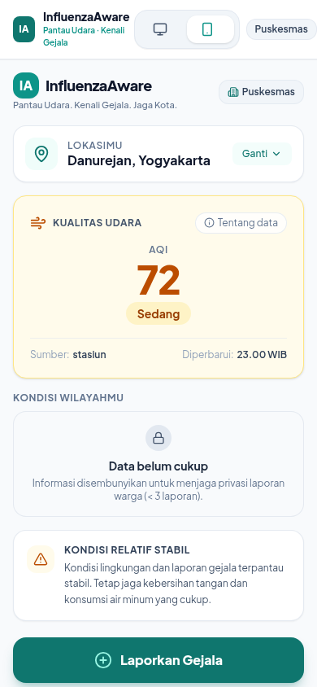
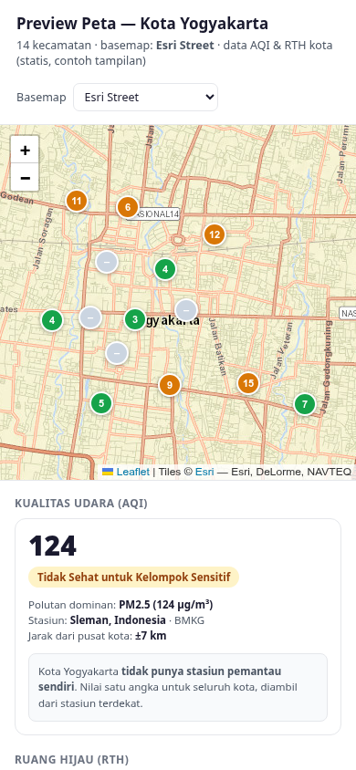

# Asap-Kenalpot/Influenza Aware

Pantau Udara. Kenali Gejala. Jaga Kota..

Platform pemantauan kualitas udara dan sinyal kesehatan pernapasan komunitas
tingkat kecamatan untuk Kota Yogyakarta. Dibuat untuk Hackathon JOINTS x
INSPIRE 2026 (tema Healthcare).

## Singkatnya

InfluenzaAware itu satu situs web. Siapa pun bisa membukanya, memilih
kecamatannya, lalu mencentang gejala yang sedang dialami: batuk, demam, sesak,
dan sembilan gejala lain. Tidak perlu membuat akun dan tidak perlu menulis
nama.

Semua jawaban dari warga se-Yogyakarta dikumpulkan aplikasi lalu digambar di
peta. Dari situ kelihatan kecamatan mana yang warganya sedang banyak sakit,
sehingga puskesmas tahu lebih dulu harus memeriksa ke mana. Yang mengisi juga
langsung dapat saran: cukup istirahat di rumah, periksa ke puskesmas, atau
segera ke gawat darurat.

Bisa dibuka dari HP maupun komputer.

## Tangkapan layar

| Halaman lapor | Peta (pratinjau desain) |
|---|---|
|  |  |

## Masalah yang diselesaikan

Ketika kasus pernapasan di suatu daerah mulai meningkat, biasanya baru
ketahuan setelah banyak orang berobat. Padahal gejalanya sudah muncul lebih
dulu di rumah masing-masing, hanya saja tidak ada yang mencatatnya.

InfluenzaAware mengumpulkan catatan itu. Warga melaporkan gejala yang sedang
dialami tanpa menuliskan identitas apa pun. Laporan tersebut diubah menjadi
kategori triase lalu dipetakan bersama data kualitas udara, sehingga terlihat
kecamatan mana yang gejalanya sedang menanjak dan puskesmas bisa memeriksa
lebih awal.

## Cara kerja

1. Warga memilih satu dari 14 kecamatan Kota Yogyakarta.
2. Warga memilih gejala (batuk, demam, sesak, dan 9 gejala lain) serta berapa
   hari sudah dialami. Gejala dipilih dari daftar, bukan isian bebas, supaya
   datanya bisa dihitung.
3. Jawaban itu diolah enam aturan di `backend/src/triase.ts` menjadi tiga
   tingkat: gawat darurat, perlu pemeriksaan, atau ringan, beserta saran
   tindakan.
4. Satu perangkat hanya bisa mengirim satu laporan per hari, dijaga lewat hash
   perangkat tanpa menyimpan identitas.
5. Halaman peta menampilkan sebaran laporan per kecamatan (lapisan gejala) dan
   kualitas udara (lapisan AQI).
6. Halaman dashboard merangkum wilayah yang laporannya naik, dipakai pengelola
   atau puskesmas, dan bisa diekspor ke CSV.

Kalau laporan sebuah kecamatan kurang dari 3 dalam 7 hari, angkanya
disembunyikan dan diberi label "data belum cukup". Ini untuk melindungi
privasi warga di wilayah yang laporannya masih sedikit.

## Isi repositori

| Folder | Isi |
|---|---|
| `backend/` | API dan basis data. Bun + TypeScript + SQLite |
| `frontend/` | Antarmuka web. React + Vite + Tailwind + Leaflet |
| `shared/` | Tipe TypeScript yang dipakai bersama frontend dan backend |
| `data/` | Daftar 14 kecamatan serta nilai AQI dan RTH terakhir |
| `docs/` | Kontrak API, lihat `docs/API.md` |

## Menjalankan di komputer sendiri

Prasyarat: [Bun](https://bun.sh) 1.4 atau lebih baru, dan Node.js 20 atau
lebih baru.

### 1. Backend

```bash
cd backend
bun install
cp .env.example .env      # opsional: isi WAQI_TOKEN untuk data AQI asli
bun run index.ts
```

Server jalan di `http://localhost:3000`. Saat pertama dijalankan, tabel
kecamatan dan daftar gejala terisi otomatis dari `data/lokasi.json`, jadi tidak
ada langkah migrasi manual.

`WAQI_TOKEN` gratis dari <https://aqicn.org/data-platform/token/>. Tanpa token
aplikasi tetap jalan, memakai nilai AQI terakhir yang tersimpan di
`data/lingkungan.json`.

Untuk memeriksa API: `bun test` menjalankan uji kontrak (memakai basis data
sementara, data asli tidak terganggu).

### 2. Frontend

```bash
cd frontend
npm install
npm run dev
```

Buka `http://localhost:5173`. Saat mode pengembangan, Vite otomatis
meneruskan permintaan `/api` ke backend di port 3000, jadi tidak perlu
konfigurasi tambahan.

Untuk mencoba dari HP: jalankan `npm run dev -- --host`, lalu buka alamat IP
laptop dari peramban HP (pastikan satu jaringan Wi-Fi).

### 3. Data contoh untuk demo

```bash
cd backend
bun run seed:demo              # isi data contoh
bun run seed:demo -- --hapus   # hapus lagi
```

## Konfigurasi backend

| Env | Default | Fungsi |
|---|---|---|
| `PORT` | `3000` | port server |
| `WAQI_TOKEN` | (kosong) | token WAQI untuk mengambil AQI terbaru |
| `DASHBOARD_TOKEN` | (kosong) | kalau diisi, `/api/dashboard*` butuh `Authorization: Bearer <token>` |
| `RATE_LIMIT_PER_MIN` | `30` | batas laporan per IP per menit |
| `AQI_REFRESH` | `on` | segarkan AQI otomatis saat server start |
| `CORS_ORIGIN` | `http://localhost:5173` | origin frontend yang diizinkan |

Daftar lengkap endpoint ada di `docs/API.md`.

## Privasi

Yang disimpan hanya kecamatan, gejala, durasi, kategori triase, waktu, dan
hash perangkat. Tidak ada nama, NIK, nomor HP, maupun koordinat presisi. Header
`X-Device-Id` kalau dikirim langsung di-hash dan hanya dipakai untuk batas satu
laporan per perangkat per hari.

## Keterbatasan

- Triase bukan diagnosis. Enam aturannya masih tebakan awal dan belum
  diverifikasi tenaga medis, jadi hasilnya hanya panduan pertama, bukan
  pengganti pemeriksaan dokter.
- AQI dan RTH adalah satu nilai untuk seluruh kota, bukan per kecamatan.
  Nilainya dari stasiun BMKG terdekat via WAQI, sekitar 8 km.
- Ambang "naik" memakai aturan sederhana: minimal 5 laporan dalam 7 hari dan
  naik minimal 50% dibanding 7 hari sebelumnya.
- Batas pergantian hari memakai WIB.
- Dari formulir frontend, aturan triase nomor 5 (kelompok rentan) belum aktif
  karena antarmuka belum mengirim field opsionalnya. Aturan 1 sampai 4 dan 6
  sudah jalan.

## Sumber data

| Data | Sumber |
|---|---|
| Batas 14 kecamatan Kota Yogyakarta | `data/lokasi.json` |
| Kualitas udara (AQI) | Stasiun BMKG terdekat via WAQI/aqicn.org |
| Ruang terbuka hijau (RTH) | Pemerintah Kota Yogyakarta |
| Peta | OpenStreetMap, © kontributor OpenStreetMap |
